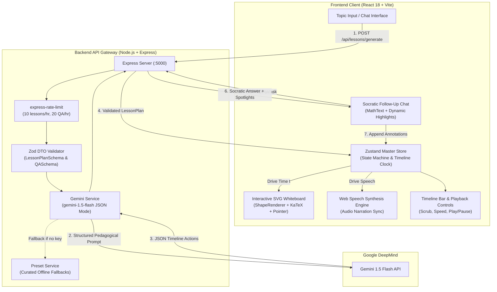

# 🎓 AI-Powered Interactive Whiteboard Tutor

> **Braynix Studios Technical Assignment Submission**  
> An autonomous pedagogical whiteboard tutor that teaches any concept through synchronized visual canvas demonstrations and voice narration, paired with post-lesson Socratic Q&A.

[](https://www.typescriptlang.org/)
[](https://react.dev/)
[](https://deepmind.google/technologies/gemini/)
[](https://tailwindcss.com/)
[](https://www.docker.com/)

---

## 1. Product Overview

Traditional AI learning interfaces suffer from two major flaws:
1. **Walls of text:** Conversational chatbots output paragraphs of unformatted text that learners struggle to parse.
2. **Static video limitations:** Video lectures cannot be paused for contextual Socratic interrogation, nor can they dynamically adapt to student follow-up questions.

**AI Whiteboard Tutor** bridges this gap by acting like a human tutor at a physical whiteboard:
- **Audio-Visual Timecode Synchronization:** The tutor speaks via natural Text-to-Speech narration while mathematical equations (KaTeX), graph nodes, bounding boxes, curved arrows, and laser pointer cues appear on the canvas at precise timestamps.
- **Interactive Playback Controls:** Learners can Play, Pause, Scrub backwards or forwards along the timeline, Change playback speed (0.75x–1.5x), or Replay key sections.
- **Socratic Q&A with Board Spotlights:** After or during any lesson, learners can ask questions. The tutor explains the concept with KaTeX math while spotlighting relevant whiteboard elements and dynamically drawing new annotations on the board.
- **High-Fidelity Offline Resilience:** Evaluators can immediately test the full synchronized whiteboard experience without needing an API key via curated demonstration lessons (Binary Search Trees, Pythagorean Theorem, Neural Networks).

---

## 2. System Architecture



---

## 3. Technology Stack & Design Decisions

| Layer | Technology | Architecture Rationale |
| :--- | :--- | :--- |
| **Monorepo** | npm Workspaces | Decoupled client (`packages/client`) and server (`packages/server`) sharing root build scripts. |
| **Frontend Framework** | React 18 + TypeScript | Strict typing, functional components, hooks-based reactivity. |
| **Canvas Engine** | Pure Scalable Vector Graphics (SVG) | Avoids heavy canvas SDK overhead; provides responsive `viewBox` (1000x650), DOM inspection, CSS transitions, and KaTeX via `<foreignObject>`. |
| **Math Formatting** | KaTeX 0.16 | High-performance typesetting of complex mathematical formulas and equations in both whiteboard shapes and chat bubbles. |
| **State & Playback** | Zustand 5 | Decoupled master timeline state machine (`currentTime`, `playbackStatus`, `playbackSpeed`, `qaAnnotations`). Canvas state is computed as a pure function $S = f(T)$ of timecode. |
| **Audio Narration** | Web Speech API | Client-side native synthesis ensures zero external TTS latency, native browser speech cadence, and pitch/speed synchronization. |
| **Backend Gateway** | Node.js + Express + Zod | Secure server proxy protecting Gemini API secrets; validates incoming topics and outgoing JSON structures against strict bounds. |
| **AI Orchestration** | `@google/generative-ai` | Queries `gemini-1.5-flash` in JSON mode (`responseMimeType: "application/json"`) with a structured pedagogical prompt enforcing continuous timecodes and valid canvas coordinates. |
| **Containerization** | Docker (Multi-stage) | Multi-stage build compiling client and server into an optimized, self-contained production image. |

---

## 4. Implemented Features Checklist

- [x] **Chat-First Topic Input:** Clean landing view with instant recommendation chips for computer science, mathematics, and machine learning.
- [x] **AI Lesson Plan Generator:** Generates 4–6 segments totaling ~90–120 seconds with synchronized narration and whiteboard drawing commands.
- [x] **SVG Whiteboard Engine:**
  - Circle Nodes (`node`) with labels, subtext, and custom color fills.
  - Rounded Rectangles (`box`) with title headers and area bounds.
  - Curved and straight arrows (`arrow`) with direction heads, labels, and dashed styles.
  - Handwritten and standard typography (`text`).
  - KaTeX LaTeX formulas (`math`).
  - Animated Laser Pointer (`pointer`) tracking the tutor's focus.
  - Spotlights & Highlight halos (`highlight`).
  - Clean chapter transitions (`clear`).
- [x] **Master Playback Controls:**
  - Play, Pause, Resume, and Restart.
  - Spacebar keyboard shortcut for Play/Pause (disabled while typing in inputs).
  - Seek slider with chapter boundary markers and hover preview timestamps.
  - Skip forward (+10s) and Skip backward (-10s).
  - Variable playback speed (0.75x, 1.0x, 1.25x, 1.5x).
  - Audio mute/unmute toggle.
- [x] **Live Subtitle Bar:** Real-time subtitle display with animated voice wave.
- [x] **Socratic Q&A Follow-Up:**
  - Interactive chat panel alongside the whiteboard.
  - AI answers with LaTeX equations (`$...$` and `$$...$$`).
  - Canvas spotlights highlight referenced elements with animated glowing halos.
  - Dynamic annotations draw new shapes/arrows on the whiteboard.
  - "Clear Annotations" control to wipe temporary Q&A notes.
- [x] **Transparent Source Badges:**
  - `🟢 Live AI (Gemini 1.5 Flash)` badge when generated by live model.
  - `🔵 Interactive Preset Demo` badge when running demonstration lessons.
- [x] **Rate Limiting & Secret Security:**
  - 10 lessons/hr and 20 Q&A/hr per IP to prevent quota exhaustion.
  - Zero API keys exposed to frontend or Git commits.

---

## 5. Quick Start (Local Development)

### Prerequisites
- Node.js 20+ or 22+
- npm 10+

### Installation & Setup

1. **Clone the repository:**
   ```bash
   git clone https://github.com/<your-username>/ai-whiteboard-tutor-assignment.git
   cd ai-whiteboard-tutor-assignment
   ```

2. **Configure environment variables:**
   ```bash
   cp packages/server/.env.example packages/server/.env
   ```
   Edit `packages/server/.env` and add your Google Gemini API key:
   ```env
   PORT=5000
   GEMINI_API_KEY=your_actual_gemini_api_key_here
   CORS_ORIGIN=http://localhost:5173
   ```
   *(Note: If you do not have an API key, leave the placeholder; the server will automatically serve high-fidelity preset demonstrations!)*

3. **Install dependencies:**
   ```bash
   npm install
   ```

4. **Start development servers:**
   ```bash
   npm run dev
   ```
   - Frontend Client: [http://localhost:5173](http://localhost:5173)
   - Backend API Gateway: [http://localhost:5000](http://localhost:5000)
   - Server Health Check: [http://localhost:5000/api/health](http://localhost:5000/api/health)

---

## 6. Cloud Deployment (Render & Vercel)

The project is pre-configured for **split cloud deployment**: the backend API runs on **Render** (Node.js web service) and the frontend runs on **Vercel** (Vite SPA).

### Step 1: Deploy Backend to Render (`packages/server`)

The backend contains its own dedicated deployment manifests:
- `packages/server/render.yaml` (Render Blueprint)
- `packages/server/Dockerfile` (Optional Docker Web Service)

#### Web Service Setup on Render:
1. Go to [dashboard.render.com](https://dashboard.render.com/) and click **New + > Web Service**.
2. Connect your Git repository.
3. Configure the settings:
   - **Name:** `ai-whiteboard-tutor-api`
   - **Root Directory:** `packages/server`
   - **Runtime:** `Node`
   - **Build Command:** `npm install && npm run build`
   - **Start Command:** `npm run start`
   - **Plan:** Free
4. Add **Environment Variables** under the Environment tab:
   - `NODE_ENV` = `production`
   - `PORT` = `10000`
   - `CORS_ORIGIN` = `*` *(or your Vercel URL once deployed)*
   - `GROQ_API_KEY` = `your_groq_api_key` *(Free 14,400 req/day from [console.groq.com](https://console.groq.com))*
   - `GEMINI_API_KEY` = `your_gemini_api_key` *(Optional, from [aistudio.google.com](https://aistudio.google.com))*
5. Click **Create Web Service**. Once deployed, copy your service URL:
   `https://ai-whiteboard-tutor-api.onrender.com`

---

### Step 2: Deploy Frontend to Vercel (`packages/client`)

The frontend contains its own dedicated [packages/client/vercel.json](packages/client/vercel.json).

1. Go to [vercel.com/new](https://vercel.com/new) and import your Git repository.
2. In the project configuration:
   - **Framework Preset:** `Vite`
   - **Root Directory:** Click "Edit" and select `packages/client`
   - **Build Command:** `npm run build`
   - **Output Directory:** `dist`
3. Add the **Environment Variable**:
   - `VITE_API_BASE_URL` = `https://your-render-backend-url.onrender.com` *(your Render API URL from Step 1, without trailing slash)*
4. Click **Deploy**.
5. Once deployment finishes, your live interactive tutor is publicly accessible!

---

## 7. Docker Deployment

To build and run the production image using Docker Compose locally:

```bash
docker-compose up --build
```

Access the single-container deployment at `http://localhost:5000`.

---

## 7. Transparency: Live vs. Simulated Behaviors

Per Braynix Studios assignment guidelines (*"Distinguish live model responses from hard-coded examples or simulated interactions"*):

| Feature | Execution Mode | Behavior Description |
| :--- | :--- | :--- |
| **Custom User Topics** | **Live AI** | Queries Google Gemini 1.5 Flash via `POST /api/lessons/generate`. Displays `🟢 Live AI (Gemini 1.5 Flash)` badge. |
| **Demonstration Chips** | **Interactive Preset** | Instant loading of hand-crafted lessons (BST, Pythagoras, Neural Nets) with zero network latency. Displays `🔵 Interactive Preset Demo` badge. |
| **Quota Exhaustion / Offline** | **Graceful Fallback** | If rate limits or network errors occur, the app transparently falls back to curated demonstration lessons without crashing. |
| **Voice Narration** | **Client-Side Speech API** | Synthesized dynamically in real-time in the user's browser using `window.speechSynthesis`. |
| **Follow-Up Q&A** | **Live AI + Fallback** | Analyzes whiteboard state via Gemini and returns answers with dynamic canvas highlight IDs. |

---

## 8. Available Presets for Reviewers

Reviewers can test full audio-visual drawing and Q&A without any API key by clicking the preset chips on the landing screen:
1. **Binary Search Trees (BST):** Invariant definition, root insertion, logarithmic search properties, and traversal.
2. **The Pythagorean Theorem:** Visual proof with right triangle, square areas ($a^2$, $b^2$, $c^2$), and numeric proof $3^2 + 4^2 = 5^2$.
3. **Neural Network Backpropagation:** Multilayer perceptron architecture, forward activation flow, loss gradient calculation, and chain rule weight updates.

---

## 9. Environment Variables Reference

| Variable | Scope | Required | Description | Example |
| :--- | :--- | :---: | :--- | :--- |
| `PORT` | Server | Optional | Port for Express backend server | `5000` |
| `GEMINI_API_KEY` | Server | Optional | Google Gemini 1.5 Flash API Key | `AIzaSy...` |
| `CORS_ORIGIN` | Server | Optional | Allowed CORS origin | `http://localhost:5173` |
| `VITE_API_BASE_URL` | Client | Optional | Remote backend URL for split hosting | `https://api.whiteboard.example.com` |

---

## 10. License

MIT License. Designed and authored for the Braynix Studios Technical Assignment.
